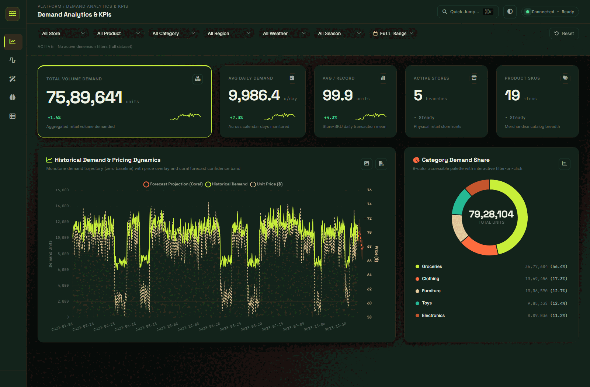
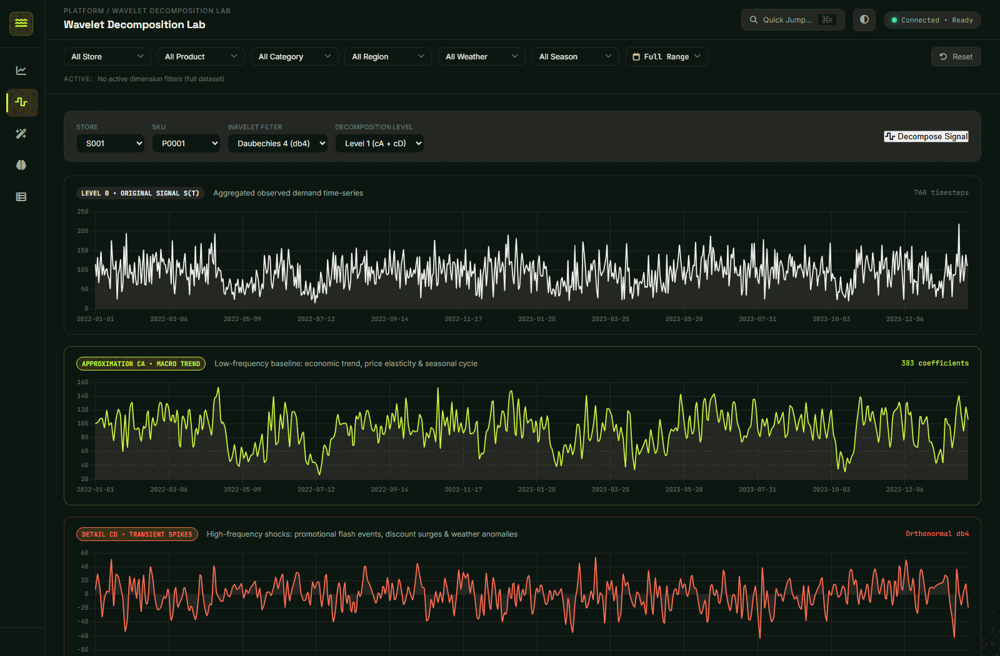
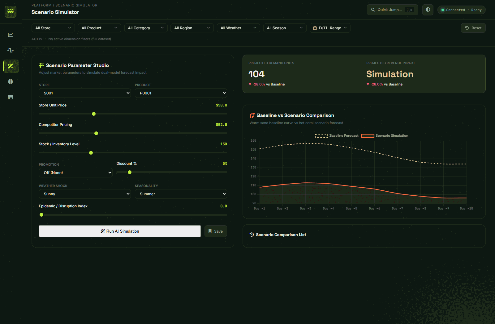
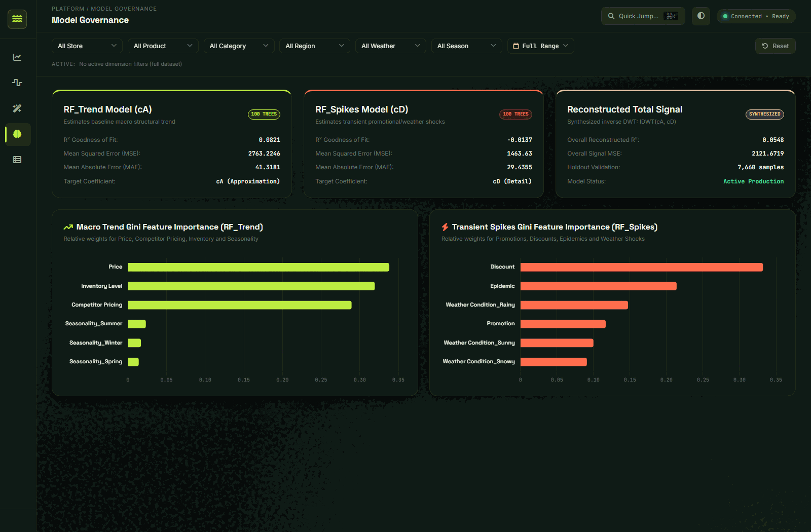
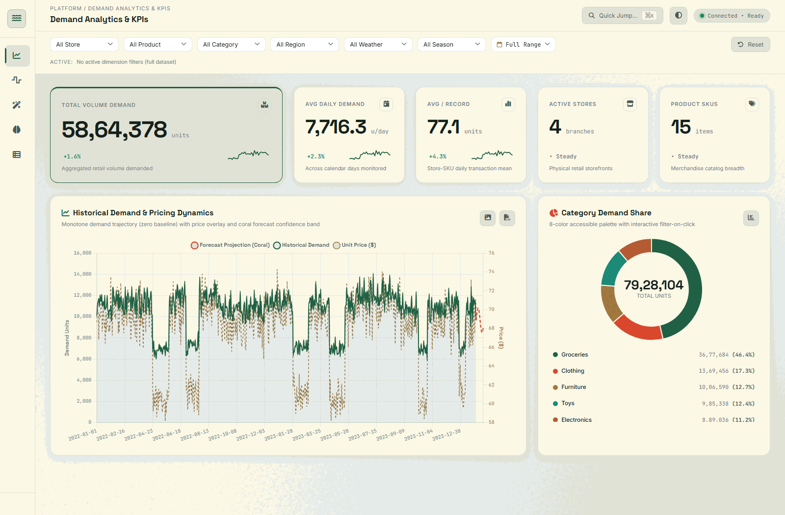
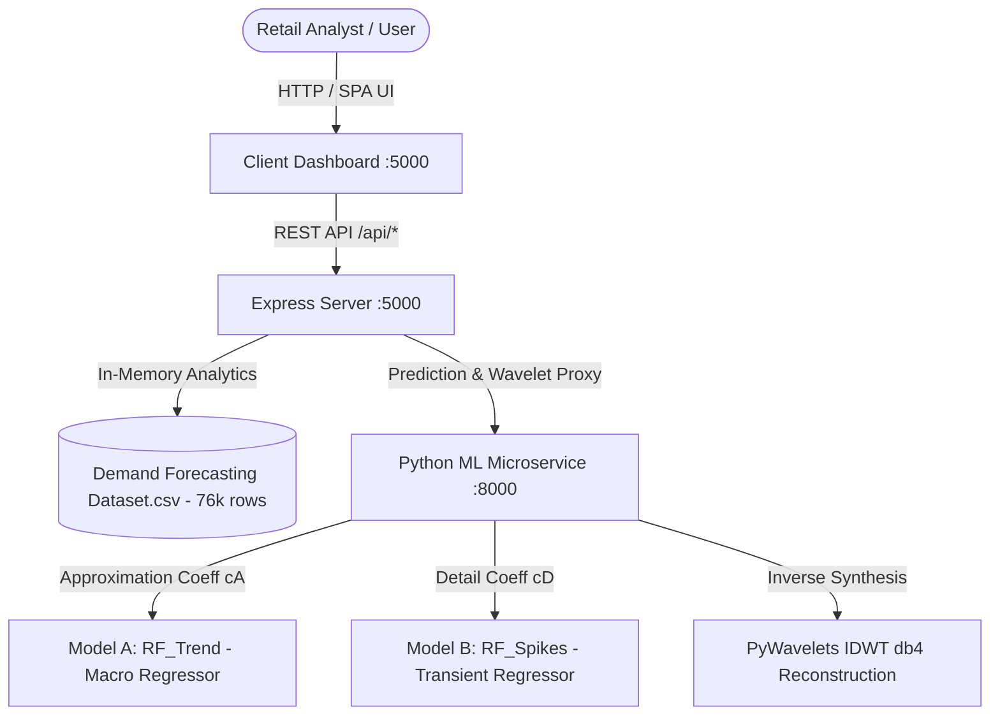

# Wavelet Retail AI — Multi-Resolution Demand Forecasting Platform

An enterprise-grade, full-stack machine learning retail demand forecasting application. The system integrates **Discrete Wavelet Transforms (DWT with Daubechies 4 filters)** with **Dual Random Forest Regressors** to achieve time-frequency multi-resolution demand forecasting, what-if scenario simulations, and governance diagnostics across 76,000 historical transactions.

---

## 📸 Platform Interface

| Demand Analytics & KPIs (Dark "Ink" Theme) | Wavelet Decomposition Lab |
| :---: | :---: |
|  |  |

| AI Scenario Simulator | Model Governance & Feature Importance |
| :---: | :---: |
|  |  |

| Paper Theme (Light Mode) |
| :---: |
|  |

---

## 🏛️ System Architecture



### 1. Mathematical Innovation: Discrete Wavelet Transform (db4)
Retail demand is an aggregate signal composed of two decoupled forces:
1. **Low-Frequency Macroeconomic Trend ($c_A$):** Long-term price elasticity, competitor pricing pressure, store baseline footfall, and seasonal lifecycles.
2. **High-Frequency Transient Spikes ($c_D$):** Promotional flash sales, markdown discounts, localized epidemic alerts, and sudden weather anomalies.

Standard forecasting models suffer from lag distortion and noise amplification when trying to fit both simultaneously. By decomposing demand into $c_A$ and $c_D$ via orthonormal Daubechies 4 ($db4$) wavelets:
$$\text{Demand}(t) \xrightarrow{\text{DWT } (db4)} [c_A(t), c_D(t)]$$
- **Model A (`RF_Trend`):** Predicts structural trend $c_A$ using macro features (Price, Competitor Pricing, Inventory, Seasonality).
- **Model B (`RF_Spikes`):** Predicts transient impulses $c_D$ using shock features (Promotion, Discount, Epidemic, Weather).
- **Reconstruction:** Synthesized back via Inverse Discrete Wavelet Transform ($IDWT$):
$$\widehat{\text{Demand}} = \text{IDWT}(\widehat{c_A}, \widehat{c_D}, \text{'db4'})$$

---

## 🏃 Quick Start Guide

### Option A: Node.js Unified Launcher (Recommended)
From the project root:
```bash
npm start
# or: node start.js
```
*Spawns both the FastAPI ML service (:8000) and Express server (:5000) concurrently.*

### Option B: Windows Helper Scripts
Double-click `scripts/run.bat` or run:
```powershell
powershell -File scripts/run.ps1
```

### Option C: Manual Launch (Separate Terminals)
**Terminal 1 (Python ML Microservice):**
```bash
cd ml-service
pip install -r requirements.txt
python main.py
```
*(Runs on `http://localhost:8000`)*

**Terminal 2 (Express Backend & Dashboard):**
```bash
cd server
npm install
node src/index.js
```
*(Runs on `http://localhost:5000`)*

---

## 🌐 Endpoints & URLs

- **Interactive Dashboard:** [http://localhost:5000](http://localhost:5000)
- **Express API Health:** [http://localhost:5000/api/health](http://localhost:5000/api/health)
- **ML Service Health:** [http://localhost:8000/health](http://localhost:8000/health)
- **Model Metrics:** [http://localhost:5000/api/model/metrics](http://localhost:5000/api/model/metrics)
- **Wavelet Decomposition API:** `GET /api/demand/wavelet?storeId=S001&productId=P0001`
- **Predict API:** `POST /api/forecast`

---

## 🚀 Deployment & Cloud Hosting

Both services can be deployed as standalone processes or Docker containers.

### Environment Variables

#### Express Backend (`server/.env`)
| Variable | Default | Description |
| :--- | :--- | :--- |
| `PORT` | `5000` | Port for Express server and dashboard UI |
| `HOST` | `0.0.0.0` | Host address binding |
| `NODE_ENV` | `production` | Environment mode (`development` or `production`) |
| `ML_SERVICE_URL` | `http://localhost:8000` | Internal URL pointing to the FastAPI service |
| `DATA_PATH` | `./data/Demand Forecasting Dataset.csv` | Relative or absolute path to dataset CSV |
| `CORS_ORIGIN` | `*` | Allowed CORS origins (comma-separated or `*`) |

#### ML Microservice (`ml-service/.env`)
| Variable | Default | Description |
| :--- | :--- | :--- |
| `PORT` | `8000` | Port for FastAPI Uvicorn server |
| `HOST` | `0.0.0.0` | Host address binding |
| `CORS_ORIGINS` | `*` | Allowed origins (set to frontend domain in production) |

### Production Deployment Commands
```bash
# 1. Install dependencies
npm --prefix server install --production
pip install -r ml-service/requirements.txt

# 2. Run ML Microservice in production
uvicorn ml-service.main:app --host 0.0.0.0 --port 8000

# 3. Run Express Backend in production
node server/src/index.js
```
